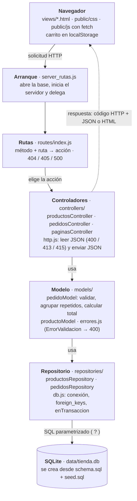

# Arquitectura — MVC organizado en capas

Un solo proceso Node.js con módulos nativos (`node:http`, `node:fs`, `node:sqlite`). Sin dependencias externas.

Las flechas sólidas son dependencias de llamada: cada capa solo conoce a la de abajo. Las vistas (`paginasController`) no pasan por el modelo porque solo entregan archivos HTML, CSS y JS.

## Responsabilidades

| Capa | Archivos | Hace | No hace |
|---|---|---|---|
| Arranque | `server_rutas.js` | Abre la base, crea el servidor HTTP, delega cada solicitud a `routes/` | Rutas, reglas o SQL |
| Rutas | `routes/index.js` | Elige la acción según método y ruta; responde 404, 405 y 500 en JSON para la API | Validar pedidos |
| Controladores | `controllers/*.js` | Leen el cuerpo (JSON, Content-Type, tamaño), llaman al modelo y eligen código HTTP (200, 201, 400, 404, 413, 415) | SQL ni cálculos |
| Vistas | `views/*.html`, `public/` | Interfaz y recursos estáticos; `public/js` consume la API con `fetch` | Decidir precios o totales |
| Modelo | `models/*.js` | Reglas obligatorias, agrupación de repetidos, cálculo con precios de SQLite; lanza `ErrorValidacion` | Conocer `req`/`res` |
| Repositorio | `repositories/*.js` | Consultas parametrizadas (`?`), conexión, `PRAGMA foreign_keys`, `enTransaccion` | Enviar respuestas HTTP |

**Dependencias:** controlador → modelo → repositorio → SQLite. Ningún archivo de `models/` o `repositories/` importa nada de `controllers/` ni usa `req`/`res`.

## Recorrido de un GET

`GET /api/pedidos`

1. `server_rutas.js` → `manejarSolicitud(req, res)` en `routes/index.js`.
2. La tabla de rutas encuentra `['GET', '/api/pedidos', pedidosController.listar]`.
3. `pedidosController.listar` → `pedidoModel.listarPedidos()`.
4. `pedidosRepository.listar()` ejecuta un `JOIN` entre `pedidos`, `detalle_pedido` y `productos` y agrupa las filas por pedido.
5. El controlador responde `200` con `enviarJSON` (arreglo, `[]` si no hay pedidos).

## Recorrido de un POST

`POST /api/pedidos`

1. `routes/index.js` → `pedidosController.crear`.
2. `leerCuerpoJSON` (`controllers/http.js`): sin `application/json` → 415; demasiado grande → 413; JSON mal formado → 400.
3. `pedidoModel.registrarPedido(datos)`:
   - `validarEntrada`: nombre y correo con `trim()`, items no vacíos, ids y cantidades enteros positivos; reúne todos los errores.
   - `agruparRepetidos`: suma cantidades del mismo producto.
   - `productosRepository.buscarPorIds` → precios desde SQLite; si falta alguno → `ErrorValidacion`.
   - Calcula `precio_unitario`, subtotales y total.
4. `pedidosRepository.crear` → `enTransaccion`: `INSERT` en `pedidos` + un `INSERT` por detalle; si algo falla, `ROLLBACK`.
5. El controlador responde `201` con el pedido guardado (o `400` con `{ error, detalles }` si hubo `ErrorValidacion`).
