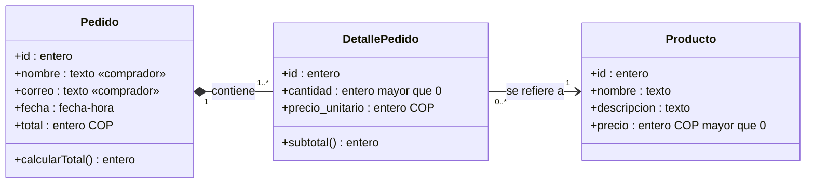
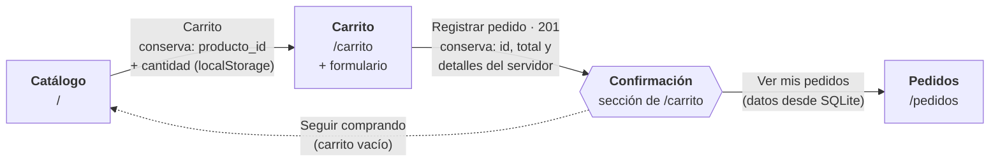
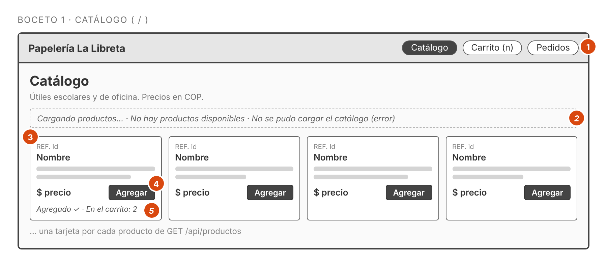
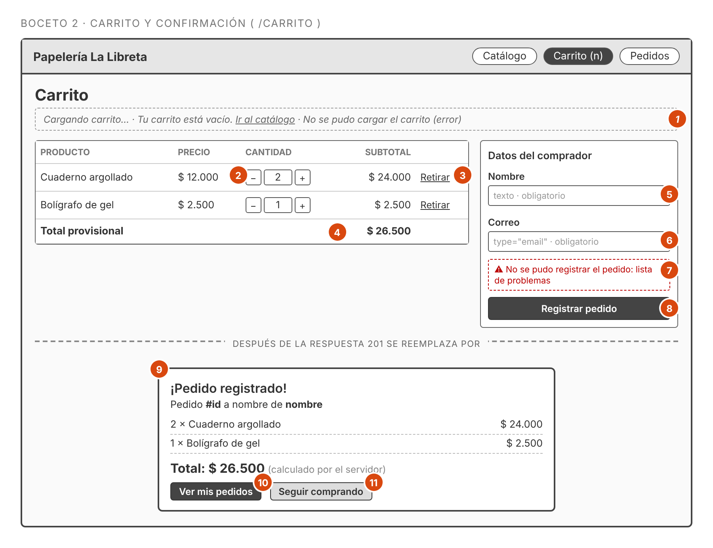
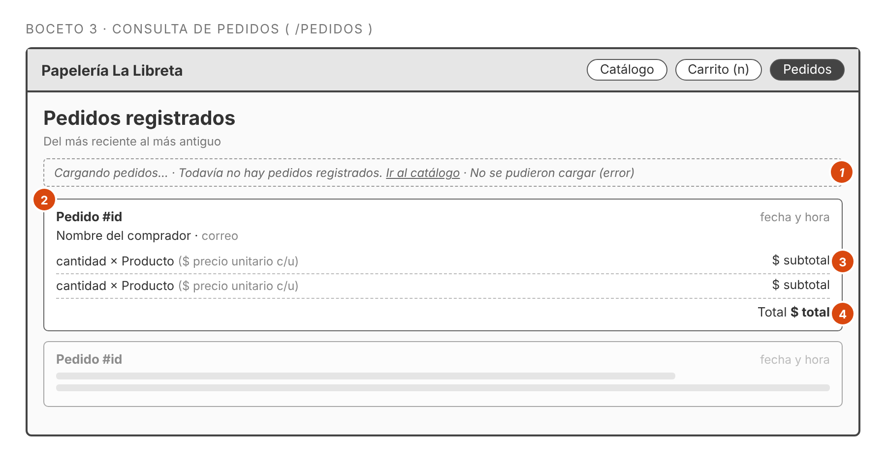

# Aplicación de OOHDM — Papelería La Libreta

Los cuatro productos describen **lo que está implementado** en este repositorio. Los diagramas usan Mermaid (GitHub los dibuja automáticamente).

---

## 1. Diseño conceptual

### Diagrama de clases del dominio

### Explicación de los conceptos

| Concepto | Qué representa | Reglas |
|---|---|---|
| **Producto** | Artículo del catálogo. | Precio entero positivo en pesos colombianos. Un producto puede aparecer en muchos detalles de distintos pedidos (`0..*`). |
| **Pedido** | Una compra simulada registrada. | Tiene **uno o más** detalles (`1..*`). La fecha y el id los asigna la base. El total = Σ subtotales y lo calcula el servidor. |
| **DetallePedido** | Una línea del pedido: qué producto y cuántas unidades. | Pertenece a un solo pedido (composición: sin pedido no existe) y se refiere a un solo producto. Guarda `precio_unitario` para conservar el precio usado al comprar aunque el precio del producto cambie después. `subtotal = cantidad × precio_unitario` (derivado, no se almacena). |

**Tratamiento de los datos del comprador.** Como no hay cuentas de usuario ni autenticación, el comprador **no** es una clase independiente: su nombre y correo son atributos del `Pedido` (marcados «comprador»). Así un mismo correo puede tener varios pedidos sin crear una tabla de usuarios. Ambos son obligatorios después de quitar espacios exteriores.

**Correspondencia con la base de datos:** `Producto → productos`, `Pedido → pedidos`, `DetallePedido → detalle_pedido` (ver `data/schema.sql`). La composición 1 a 1..* se garantiza con la clave foránea `pedido_id` y con la transacción que guarda pedido y detalles juntos.

---

## 2. Diseño navegacional

### Esquema de nodos y enlaces

Enlaces que no se dibujan para no saturar el esquema:

- **Menú superior** (Catálogo · Carrito · Pedidos) en las tres páginas: es el **índice de navegación** que conecta todos los nodos entre sí. La página actual se marca con `aria-current="page"`.
- **Agregar** en el catálogo no cambia de nodo: suma una unidad y muestra «Agregado ✓».
- **Registrar pedido con error** (400, 500 o sin conexión): el usuario se queda en el carrito, ve el mensaje y conserva carrito y formulario para corregir.
- Carrito vacío → enlace **«Ir al catálogo»**; pedidos vacíos → enlace **«Ir al catálogo»**.

### Contextos navegacionales

| Nodo | Contexto | Información que muestra |
|---|---|---|
| Catálogo | Todos los productos, ordenados por id | Referencia, nombre, descripción, precio y cuántas unidades ya hay en el carrito |
| Carrito | Productos agregados por el comprador | Nombre, precio, cantidad editable, subtotal, total provisional, formulario |
| Confirmación | El pedido recién creado | Id, comprador, productos con cantidades y subtotales, total del servidor |
| Pedidos | Todos los pedidos, del más reciente al más antiguo | Id, comprador (nombre y correo), fecha, productos con cantidades, total |

### Información que se conserva entre nodos

| Paso | Qué se conserva | Dónde |
|---|---|---|
| Catálogo → Carrito | Solo `producto_id` y `cantidad` de cada ítem | `localStorage` (clave `la-libreta.carrito`) |
| Carrito (al pintar) | Nombre y precio **no se guardan**: se consultan de nuevo con `GET /api/productos` | Memoria de la página |
| Carrito → Confirmación | Lo que **devuelve el servidor** (id, total, detalles con precios de SQLite) | Respuesta 201 del `POST /api/pedidos` |
| Confirmación | El carrito se vacía **solo** después del 201 | `localStorage` |
| Si el registro falla | El carrito y los datos del formulario se mantienen para corregir y reintentar | `localStorage` y formulario |
| Pedidos | Nada del navegador: todo viene de `GET /api/pedidos` | SQLite |

---

## 3. Diseño de interfaz abstracta

Bocetos de baja fidelidad: muestran **qué información, campos y botones** tiene cada vista y **qué pasa ante cada acción**, sin colores ni estilo final. Los números rojos remiten a las tablas. La fuente editable está en [`bocetos/bocetos.html`](bocetos/bocetos.html) (abrir en el navegador). Las capturas de la aplicación real están en [`evidencias/`](evidencias/).

### 3.1 Catálogo (`/`)

| # | Elemento | Tipo | Respuesta esperada |
|---|---|---|---|
| 1 | Menú Catálogo · Carrito (n) · Pedidos | Enlaces (índice) | Llevan a `/`, `/carrito` y `/pedidos`. n = unidades en el carrito (oculto si es 0). |
| 2 | Estado | Mensaje | «Cargando productos…» mientras responde `GET /api/productos`; desaparece al cargar. Si llega `[]`: «No hay productos disponibles». Si falla: mensaje de error en rojo. |
| 3 | Tarjeta de producto | Información (Producto) | Referencia (id), nombre, descripción y precio en COP. |
| 4 | **Agregar** | Botón | Suma 1 unidad en `localStorage` y actualiza el contador del menú. No cambia de página. |
| 5 | Aviso | Mensaje | «Agregado ✓ · En el carrito: n». |

### 3.2 Carrito y confirmación (`/carrito`)

| # | Elemento | Tipo | Respuesta esperada |
|---|---|---|---|
| 1 | Estado | Mensaje | «Cargando carrito…»; si no hay productos: «Tu carrito está vacío» con enlace al catálogo (también al retirar el último); si falla la API: error. |
| 2 | − / cantidad / + | Botones y campo `number` | Cambian la cantidad (entero entre 1 y 999) y recalculan subtotal y total al instante. |
| 3 | **Retirar** | Botón | Quita el producto del carrito. |
| 4 | Total provisional | Información | Suma de subtotales calculada en el navegador solo como guía; el valor final es el del servidor. |
| 5 | Nombre | Campo `text`, obligatorio | Se envía sin espacios exteriores. |
| 6 | Correo | Campo `type="email"`, obligatorio | El navegador valida el formato; el servidor vuelve a validar que no esté vacío. |
| 7 | Mensaje de error | Mensaje | Si faltan datos, o el servidor responde 400/500 o no hay conexión: mensaje comprensible con la lista de problemas. Se oculta al corregir un campo. El carrito se conserva. |
| 8 | **Registrar pedido** | Botón `submit` | Envía `POST /api/pedidos` con `nombre`, `correo` e `items` (solo `producto_id` y `cantidad`). Se desactiva y dice «Registrando…» mientras espera. |
| 9 | Confirmación | Información (respuesta 201) | Reemplaza la vista: id, comprador, productos con subtotales y total **devueltos por el servidor**. El carrito se vacía en este momento y no antes. |
| 10 | **Ver mis pedidos** | Enlace | Lleva a `/pedidos`. |
| 11 | **Seguir comprando** | Enlace | Lleva al catálogo con el carrito vacío. |

### 3.3 Consulta de pedidos (`/pedidos`)

| # | Elemento | Tipo | Respuesta esperada |
|---|---|---|---|
| 1 | Estado | Mensaje | «Cargando pedidos…»; si `GET /api/pedidos` devuelve `[]`: «Todavía no hay pedidos registrados»; si falla: error. |
| 2 | Tarjeta de pedido | Información (Pedido) | Id, fecha y hora, nombre y correo del comprador. Ordenados del más reciente al más antiguo. |
| 3 | Línea de detalle | Información (DetallePedido) | Cantidad × producto, precio unitario guardado y subtotal. |
| 4 | Total | Información | Total guardado en la base (calculado por el servidor al registrar). |

---

## 4. Implementación

La aplicación ejecutable está en este repositorio (`npm start`). El esquema de arquitectura está en [`ARQUITECTURA.md`](ARQUITECTURA.md).

### Decisiones de diseño → implementación

| # | Decisión de diseño (OOHDM) | Dónde se materializa |
|---|---|---|
| 1 | Clases Producto, Pedido y DetallePedido con composición 1 a 1..* | Tablas `productos`, `pedidos`, `detalle_pedido` con FK `pedido_id` (`data/schema.sql`); transacción en `repositories/pedidosRepository.js → crear()` usando `enTransaccion` (`repositories/db.js`) |
| 2 | El comprador es atributo del Pedido, no una clase | Columnas `nombre` y `correo` en `pedidos`; validación con `trim()` en `models/pedidoModel.js → validarEntrada()` |
| 3 | `precio_unitario` conserva el precio de compra y el total lo calcula el servidor | `models/pedidoModel.js → registrarPedido()` toma precios con `productosRepository.buscarPorIds()` e ignora precios/total del cliente |
| 4 | Nodos Catálogo, Carrito y Pedidos con menú como índice | Rutas `GET /`, `/carrito`, `/pedidos` en `routes/index.js`; vistas `views/catalogo.html`, `views/carrito.html`, `views/pedidos.html` |
| 5 | Entre Catálogo y Carrito solo viajan `producto_id` y `cantidad` | `public/js/carrito.js` (localStorage); `public/js/carritoPagina.js` vuelve a pedir nombres y precios con `GET /api/productos` |
| 6 | La confirmación es una sección del nodo Carrito y muestra lo que devuelve el servidor | `#confirmacion` en `views/carrito.html`; `mostrarConfirmacion()` en `public/js/carritoPagina.js`; `vaciarCarrito()` solo tras el 201 |
| 7 | Contexto «todos los pedidos con sus detalles» | `GET /api/pedidos` → `pedidosController.listar` → `pedidoModel.listarPedidos` → `pedidosRepository.listar()` (JOIN y agrupación) → `public/js/pedidos.js` |
